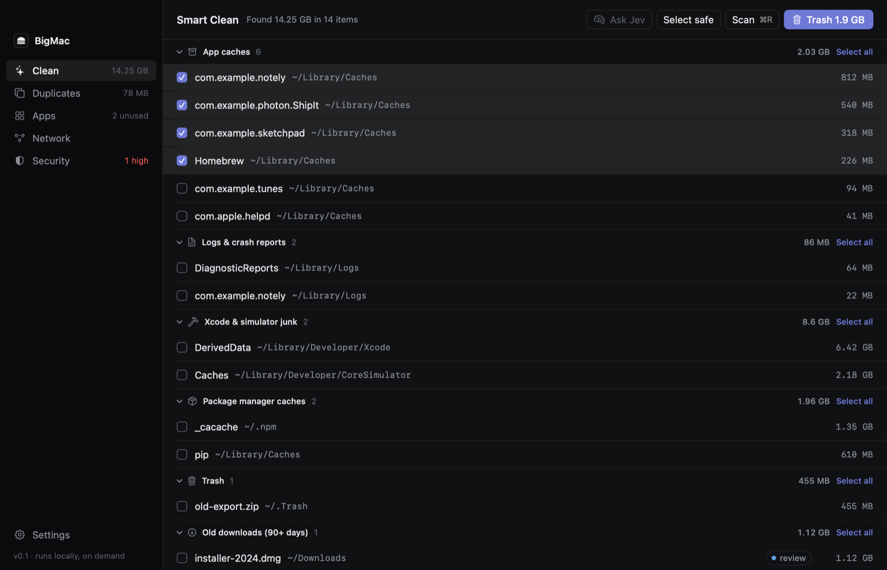
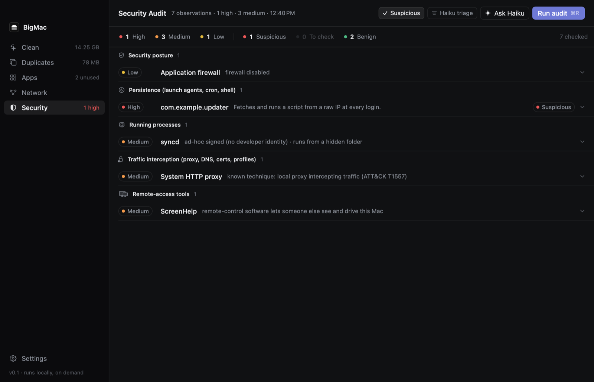
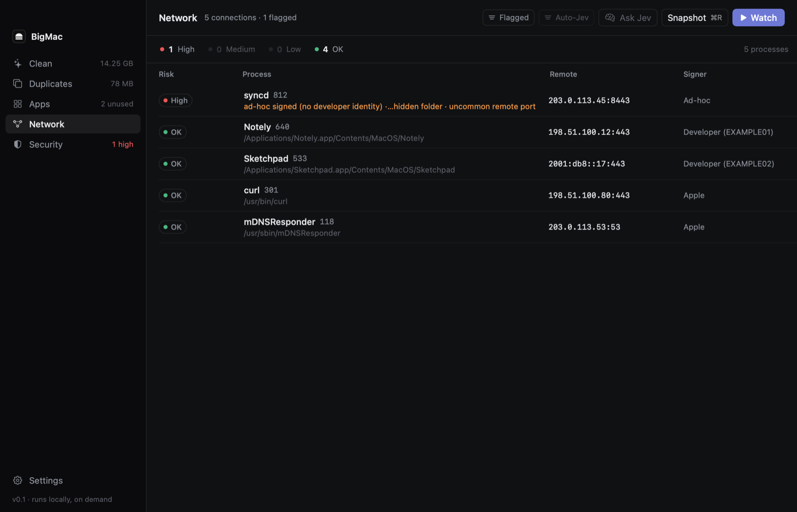
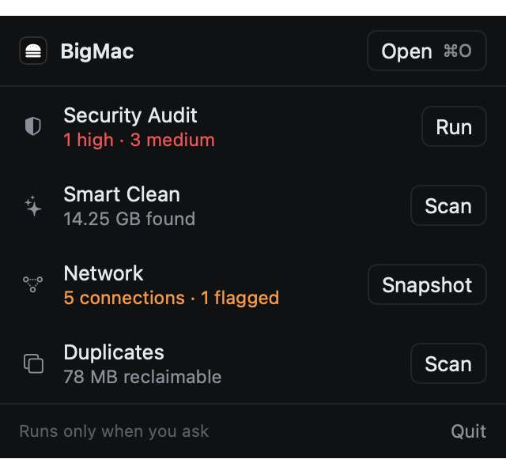

# BigMac

A small, native Mac cleaner with a network monitor and a security audit. It runs only when you ask it to.



- **Lightweight.** Pure SwiftUI with no dependencies: a 4 MB app built from about 5k lines of Swift. It has no background daemon, helper or updater.
- **On demand.** Nothing scans, polls or phones home until you click a button.
- **Reversible.** Everything goes to the Trash. System paths and app bundle internals are refused.
- **Local first.** AI triage is optional, opt-in and redacted, and goes to your own AWS account.

## What it does

| | |
|---|---|
| **Smart Clean** | App caches, logs, Xcode and simulator junk, npm/pip/gradle/CocoaPods caches, Docker leftovers, the Trash, old downloads and large files. Risky items are marked *review* and never pre-selected. |
| **Duplicates** | Byte-identical files: matched by size, then a 64 KB hash, then a full SHA-256. One copy is always kept. |
| **Apps** | Size, last used and leftover support files. Uninstalls to the Trash. |
| **Network** | Who your apps talk to (`lsof`), with risk from the code signature, binary location and port. Take a single snapshot or watch live. |
| **Security audit** | Read-only check for malware footholds: launch agents, cron, shell rc files, unsigned processes, proxy/DNS/root-certificate interception, profiles, remote-access tools, browser and system extensions, privacy grants, and Gatekeeper/SIP/FileVault/firewall posture. Matches known techniques (MITRE ATT&CK). Unwanted launch items can be removed fully: stopped, then moved to the Trash. |
| **Menu bar** | The last results and one-click Run, Scan and Snapshot. |

<p>
  
  
</p>


## Install

1. Download `BigMac-<version>-macos.zip` from [Releases](../../releases/latest), unzip it, and move `BigMac.app` to `/Applications`.
2. Open it. The app is signed and notarized by Apple, so macOS opens it without warnings.
3. Optional: for a complete scan, add BigMac in **System Settings → Privacy & Security → Full Disk Access**.

Requires macOS 14 or later.

## Build from source

```sh
swift run                         # dev build
./make-app.sh                     # build/BigMac.app (SIGN_IDENTITY="-" for ad-hoc signing)
swift run BigMac --selftest /tmp/bigmac-test
```

To notarize, set `NOTARY_PROFILE` (a profile saved with `xcrun notarytool store-credentials`) or `APPLE_ID`, `APPLE_APP_PASSWORD` and `APPLE_TEAM_ID` before running `make-app.sh`.

## Optional AI triage

Both are off until you click them:

- **Ask Haiku** (Security): flagged audit items go to Claude Haiku on Amazon Bedrock through your `aws` CLI. They are sent under opaque ids, with secrets and your home path removed. A full audit costs well under a cent. A known-technique match can't be lowered by the model.
- **Ask Jev** (Clean, Apps, Network): [TypeSafe Jev](https://docs.typesafe.ai) judges which caches are safe to delete and how suspicious a connection is. The API key is read from `TYPESAFE_API_KEY`, then the Keychain, then fetched once from AWS SSM.

Choose the AWS profile and SSM parameter (defaults: `default`, `/bigmac/typesafe-api-key`):

```sh
defaults write com.bigmac.app awsProfile <profile>
defaults write com.bigmac.app typesafeSSMName <parameter>
```

## Limits

- Without root, Network sees only your own user's processes.
- System-wide profiles and background-task items need admin; the audit tells you the command to run.
- APFS clones can make duplicate savings look bigger than they are.

Screenshots are rendered from made-up data (`swift run BigMac --snapshot <dir> demo`).

## License

[MIT](LICENSE)
