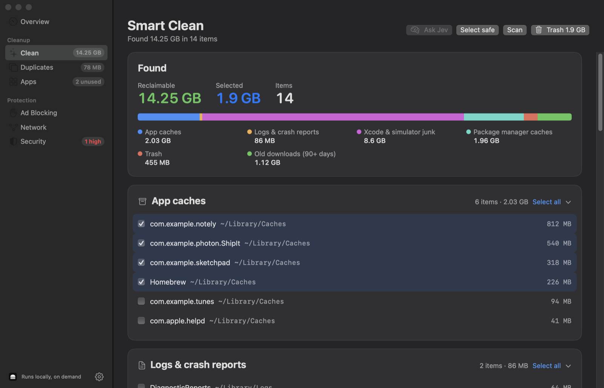
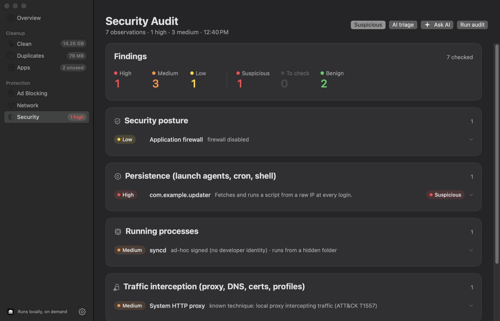
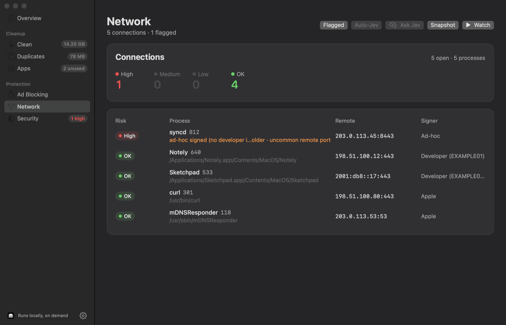
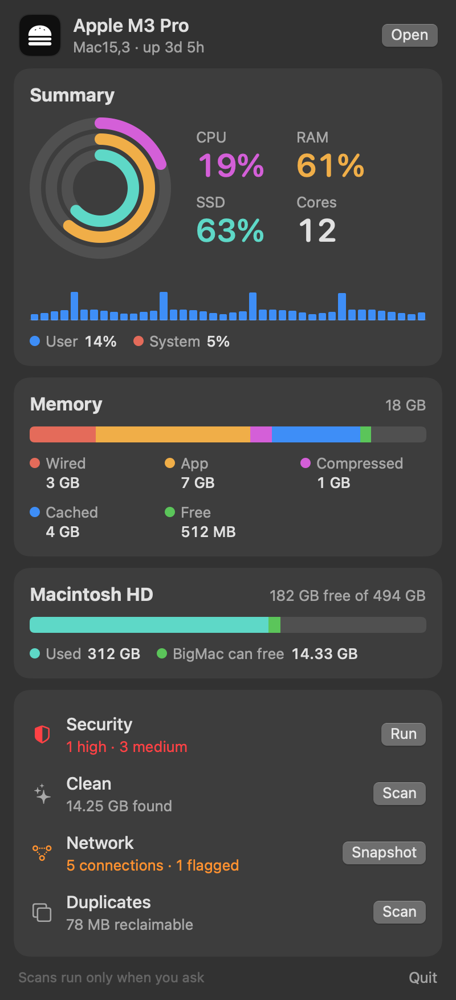

# BigMac

A small, native Mac cleaner with an ad blocker, a network monitor and a security audit. It runs only when you ask it to.



- **Native.** Pure SwiftUI with no dependencies, using the standard Mac sidebar, toolbar, controls and Settings window. It has no background daemon, helper or updater.
- **On demand.** Nothing scans, polls or phones home until you click a button.
- **Reversible.** Everything goes to the Trash. System paths and app bundle internals are refused.
- **Local first.** AI triage is optional, opt-in and redacted, and goes to your own AWS account.

## What it does

| | |
|---|---|
| **Smart Clean** | App caches, logs, Xcode and simulator junk, npm/pip/gradle/CocoaPods caches, Docker leftovers, the Trash, old downloads and large files. Risky items are marked *review* and never pre-selected. |
| **Duplicates** | Byte-identical files: matched by size, then a 64 KB hash, then a full SHA-256. One copy is always kept. |
| **Apps** | Size, last used and leftover support files. Uninstalls to the Trash. |
| **Ad Blocking** | A Safari content blocker (EasyList, EasyPrivacy and built-in pop-up and cookie-notice lists, with element hiding), a YouTube ad skipper for Safari, and an optional system-wide block list in `/etc/hosts` for other browsers and apps. Allowed sites are never blocked. |
| **Network** | Who your apps talk to (`lsof`), with risk from the code signature, binary location and port. Take a single snapshot or watch live. |
| **Security audit** | Read-only check for malware footholds: launch agents, cron, shell rc files, unsigned processes, proxy/DNS/root-certificate interception, profiles, remote-access tools, browser and system extensions, privacy grants, and Gatekeeper/SIP/FileVault/firewall posture. Matches known techniques (MITRE ATT&CK). Unwanted launch items can be removed fully: stopped, then moved to the Trash. |
| **Menu bar** | An iStatistica-style glance at CPU, memory and disk (sampled only while open), how much BigMac can free, and one-click Run, Scan and Snapshot. |

<p>
  
  
</p>


## Install

1. Download `BigMac-<version>-macos.zip` from [Releases](../../releases/latest), unzip it, and move `BigMac.app` to `/Applications`.
2. Open it. The app is signed and notarized by Apple, so macOS opens it without warnings.
3. Optional: for a complete scan, add BigMac in **System Settings → Privacy & Security → Full Disk Access**.

Requires macOS 14 or later.

## Build from source

```sh
swift run                         # dev build
./make-app.sh                     # build/BigMac.app (SIGN_IDENTITY="-" for ad-hoc signing)
swift run BigMac --selftest /tmp/bigmac-test
```

`make-app.sh` also builds the two Safari extensions with `swiftc` (SwiftPM can't build app extensions) and embeds them in `Contents/PlugIns`. A plain `swift run` has no app bundle, so it runs without them.

To notarize, set `NOTARY_PROFILE` (a profile saved with `xcrun notarytool store-credentials`) or `APPLE_ID`, `APPLE_APP_PASSWORD` and `APPLE_TEAM_ID` before running `make-app.sh`.

## Optional AI triage

Both are off until you click them.

**Ask AI** (Security) sends flagged audit items to a model you choose. Turn on the **AI triage** chip to run it after every audit; it stays off until you do. They go under opaque ids, with secrets and your home path removed. A known-technique match can't be lowered by the model. Pick a provider in **Settings → Security Audit**:

| Provider | Setup |
|---|---|
| Amazon Bedrock | Your `aws` CLI profile (`defaults write com.bigmac.app awsProfile <profile>`) |
| Anthropic API | Paste a key; Claude Haiku 5.5 costs well under a cent per audit |
| OpenAI-compatible | Base URL, model id and key: OpenAI, OpenRouter, Groq, or a local Ollama or LM Studio (no key) |

Keys are stored in your Keychain on this Mac only, or read from `ANTHROPIC_API_KEY` / `OPENAI_API_KEY`. An OpenAI-compatible key is saved for the base URL you entered and is only ever sent there, so changing the URL needs its own key; `OPENAI_API_KEY` is only sent to api.openai.com. Requests that carry a key never follow redirects.

**Ask Jev** (Clean, Apps, Network): [TypeSafe Jev](https://docs.typesafe.ai) judges which caches are safe to delete and how suspicious a connection is. Paste a key in Settings, set `TYPESAFE_API_KEY`, or fetch it once from AWS SSM (`defaults write com.bigmac.app typesafeSSMName <parameter>`).

## Ad blocking

The two Safari extensions ship inside BigMac.app. Switch them on once in Safari: **Settings → Extensions**, then tick **BigMac Ad Blocker** and **BigMac YouTube Ad Skipper** (allow the second on youtube.com). BigMac's settings reach the blocker through a shared app group. Neither extension sees the pages you browse.

**System-wide** adds about 78,000 ad and tracker servers to `/etc/hosts`, behind one admin prompt. BigMac edits only its own marked section and writes only `0.0.0.0 <name>` lines. Root checks the SHA-256 of the block BigMac prepared before installing it. Turning it off removes the section and leaves the rest of the file as it was. It blocks whole servers, not page elements. Browsers using their own secure DNS, and some VPNs, bypass it.

Refresh the lists with `scripts/hosts-blocklist.py` (system-wide). The Safari lists in `Extensions/Filters` are EasyList and EasyPrivacy converted to Safari's rule format and checked with WebKit's compiler.

Block lists: [EasyList and EasyPrivacy](https://easylist.to/) (GPLv3 or CC BY-SA 3.0), [StevenBlack hosts](https://github.com/StevenBlack/hosts) (MIT).

## Limits

- Without root, Network sees only your own user's processes.
- System-wide profiles and background-task items need admin; the audit tells you the command to run.
- APFS clones can make duplicate savings look bigger than they are.

Screenshots are rendered from made-up data (`swift run BigMac --snapshot <dir> demo`).

## License

[MIT](LICENSE). The bundled block lists keep their own licences (see Ad blocking).
